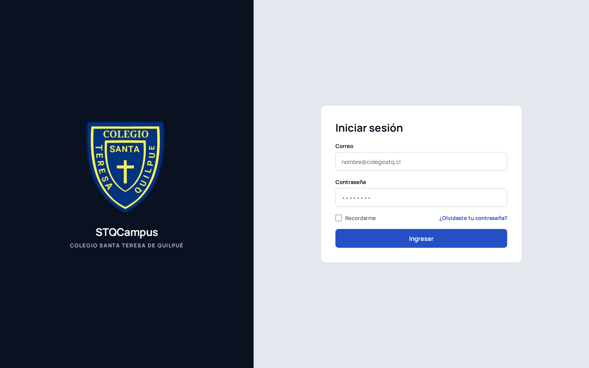
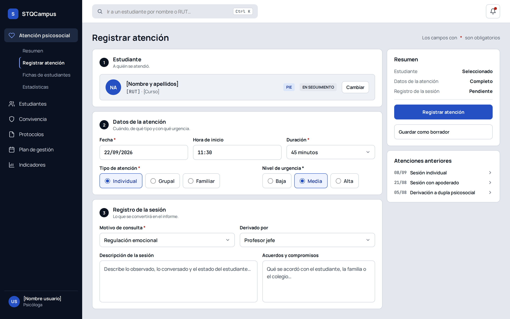
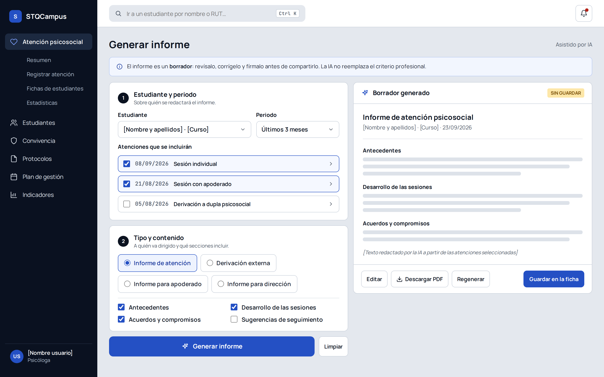
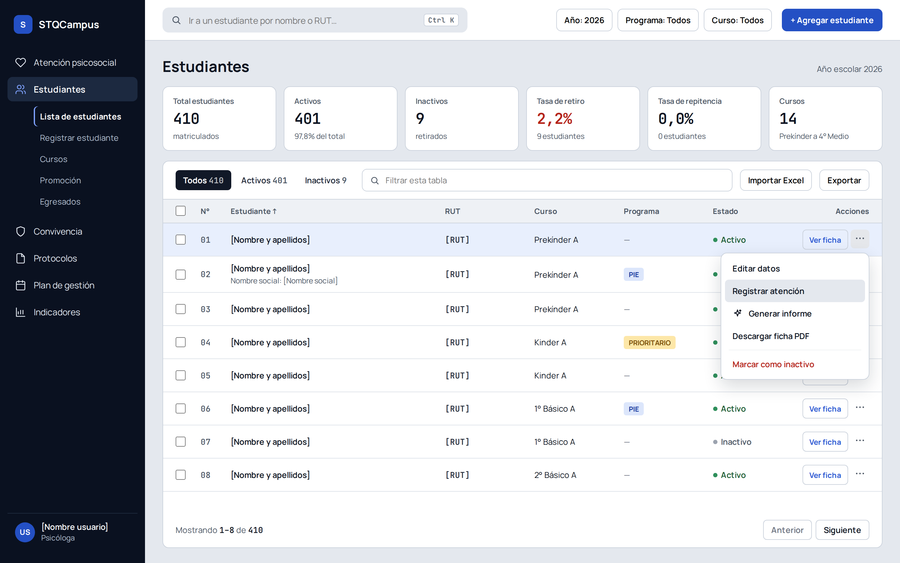
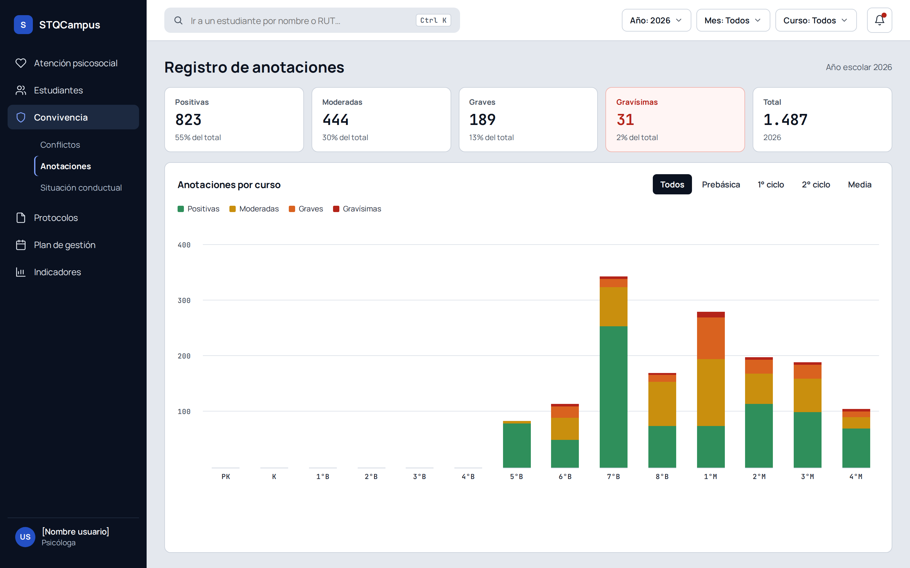

<div align="center">

# STQCampus

**Plataforma web de gestión psicosocial y convivencia escolar**

Proyecto de título · Ingeniería en Informática · Inacap La Serena

</div>

---

## Descripción

STQCampus es una plataforma web que centraliza la gestión psicosocial y de convivencia escolar del Colegio Santa Teresa de
Quilpué. Reúne en un solo lugar:

- el registro de atenciones y las fichas de estudiantes;
- los conflictos, las anotaciones y la situación conductual;
- los protocolos del reglamento interno, el plan de gestión y los indicadores de bienestar;
- el flujo de alertas de riesgo con sus plazos legales.

El sistema está pensado para el equipo psicosocial, la Encargada de Convivencia, la Coordinación PIE, Inspectoría,
profesores jefe y Dirección. Cada rol ve solo lo que necesita.

> **Estado del proyecto**
> - Las 16 pantallas del prototipo v1 están implementadas en Django con MySQL 8.
> - Se suman los módulos de los requisitos que el prototipo no dibujó: derivaciones, evaluación PIE, alertas de riesgo,
>   cumplimiento (ARCO+, retención de 15 años), bitácora y seguridad.
> - El **módulo de IA está en configuración**: Gemma 2 9B se usa sin reentrenamiento, contextualizado con un Modelfile
>   (`docs/ia/Modelfile`). La pantalla «Generar informe (IA)» ya existe y muestra los datos reales que usará, pero todavía
>   no genera contenido (ver [Módulo de IA](#módulo-de-ia-configurado-inferencia-por-implementar)).

> Los datos de demostración son **ficticios**. No cargue datos reales de estudiantes en un equipo de desarrollo.

## Capturas del prototipo

| Inicio de sesión | Atención psicosocial |
|---|---|
|  |  |

| Registro de atención | Generar informe con IA |
|---|---|
|  |  |

| Lista de estudiantes | Anotaciones |
|---|---|
|  |  |

## Módulos

**Atención psicosocial**
- **Resumen**:
  - indicadores del año: estudiantes activos, atenciones del mes, en seguimiento, conflictos y casos urgentes;
  - anotaciones por tipo;
  - pendientes por prioridad y últimas mediaciones.
- **Registrar atención** en tres pasos: estudiante; fecha, hora, duración, tipo y urgencia; motivo, derivación,
  descripción y acuerdos.
  - Se puede guardar como borrador.
  - Si el estudiante no tiene un caso abierto, se abre uno de seguimiento.
- **Fichas de estudiantes**: casos con su última atención y el filtro de urgentes. En cada caso hay una línea de tiempo,
  hitos, documentos cifrados e informes.
- **Derivaciones** al equipo y **avisos de reevaluación PIE**.
- **Estadísticas** agregadas, sin datos personales.
- **Generar informe (IA)**: espacio reservado mientras se implementa la inferencia del modelo configurado.

**Gestión de estudiantes**
- Lista con indicadores (total, activos, inactivos, tasas de retiro y repitencia, cursos), pestañas y filtros por año,
  programa (PIE, prioritario) y curso.
- Menú de acciones por fila: editar, registrar atención, generar informe, ficha en PDF y marcar como inactivo.
- Registro individual con apoderado opcional.
- Importación masiva desde Excel: incluye plantilla y se valida fila por fila antes de guardar.
- Exportación a Excel.
- Cursos agrupados por nivel, con la nómina en PDF (por curso o una selección de cursos).
- **Promoción de fin de año en tres pasos**: cursos terminales, repitentes y procesamiento. Luego, **egresados**.

**Convivencia escolar**
- Conflictos y mediaciones, con su distribución por nivel (1°–6° y 7°–4° Medio).
- Anotaciones positivas y faltas moderadas, graves y gravísimas, con un gráfico por curso y ciclo.
- Situación conductual (conductual, académica, asistencia y atrasos).
  - Aviso de inasistencia grave según el reglamento.
  - Tres descargas en Excel.
- Protocolos de actuación del reglamento interno (los ocho del Ministerio). Al activar un protocolo en una alerta de
  riesgo, queda registrado automáticamente.
- Plan de gestión de convivencia, con actividades y evidencias cifradas.
- Indicadores de bienestar.

**Alertas de riesgo, cumplimiento y administración** (requisitos del informe)
- Alertas enrutadas según la tabla «¿A quién reportar?» del reglamento.
- Constancias con hash y denuncia en 24 horas.
- Consentimientos, solicitudes ARCO+ y retención de 15 años con autorización de la Directora.
- Usuarios, roles y bitácora de auditoría encadenada.

**Cuenta**
- Mi perfil: teléfono, especialidad y último cambio de contraseña.
- «Recordarme» guarda solo el correo; la contraseña se pide siempre.
- «¿Olvidaste tu contraseña?» envía un enlace por correo válido por una hora.
- En el primer ingreso se exige cambiar la contraseña.
- Segundo factor (TOTP) para los perfiles clínicos, la Directora y el administrador.

## Decisiones de diseño

- Menú lateral único con submenús por módulo, en reemplazo de la navegación por pestañas.
- Acciones de cada fila agrupadas en un botón «Ver ficha» y un menú, en lugar de íconos de colores sin texto.
- Filtros de año, mes y curso (o nivel y programa) en la barra superior, iguales en todos los módulos. Viajan en la
  dirección de la página, así que los enlaces se pueden compartir.
- Indicadores y gráficos al inicio de cada módulo.
- Paleta de alto contraste y datos de ejemplo ficticios.
- El botón de alerta de riesgo está siempre a un clic (ícono rojo en la barra superior), por los plazos legales del
  reglamento.
- Todo funciona sin librerías externas:
  - gráficos en SVG generados en el servidor;
  - fuentes Manrope y JetBrains Mono servidas desde `static/fonts` (SIL OFL 1.1);
  - política de seguridad de contenido (CSP) estricta.

## Tecnologías

| Capa | Tecnología |
|---|---|
| Backend | Python 3.11+ · Django 5.2 · Django REST Framework |
| Base de datos | MySQL 8 (InnoDB, utf8mb4). SQLite para probar rápido |
| Frontend | Plantillas Django · HTML · CSS · JavaScript mínimo sin dependencias |
| Documentos | openpyxl (Excel) · reportlab (PDF) |
| Seguridad | AES-256-GCM (cryptography) · TOTP (pyotp) |
| Prototipo | HTML estático (carpeta `prototipo/`) |

## Estructura del repositorio

```
.
├── config/                 # configuración (variables de entorno), URLs, WSGI
├── apps/
│   ├── core/               # sedes, validadores, cifrado, filtros de la barra, Excel/PDF, menú, datos de demostración
│   ├── cuentas/            # usuarios, roles y permisos, segundo factor, perfil y contraseñas
│   ├── auditoria/          # bitácora de solo inserción encadenada por SHA-256
│   ├── estudiantes/        # lista, ficha, apoderados, cursos, importación, promoción y egresados
│   ├── casos/              # resumen, registrar atención, fichas (casos), derivaciones, hitos, documentos
│   ├── evaluacion/         # evaluación diagnóstica PIE, planes de apoyo, informes, avisos de reevaluación
│   ├── convivencia/        # conflictos, anotaciones, situación conductual, protocolos, plan de gestión, indicadores
│   ├── alertas/            # alertas de riesgo, enrutamiento según el reglamento, constancias y denuncia
│   ├── ia/                 # módulo de IA reservado (esquema de datos y pantalla; inferencia por implementar)
│   ├── cumplimiento/       # consentimientos, ARCO+, retención de 15 años
│   ├── reportes/           # estadísticas agregadas sin datos personales
│   └── api/                # API REST mínima
├── templates/  static/     # interfaz «panel analítico» adaptable a celulares
├── tests/                  # 108 pruebas automáticas
├── sql/                    # creación de base y usuarios, esquema de referencia
├── docker/  Dockerfile  docker-compose.yml
└── prototipo/              # prototipo navegable v1
    ├── index.html          # índice del prototipo
    ├── pantallas/          # las 16 pantallas en HTML (y sus fuentes)
    └── imagenes/           # capturas de cada pantalla
```

## Cómo ver el prototipo

1. Clona o descarga el repositorio.
2. Abre la carpeta en Visual Studio Code.
3. Clic derecho sobre `prototipo/index.html` → **Open with Live Server**.

También puedes abrir `prototipo/index.html` directamente en el navegador con doble clic.

## Instalación del sistema

### Arranque rápido (SQLite, 5 minutos)

Requisitos: Python 3.11 o superior.

```bash
# Clonar el repositorio
git clone https://github.com/smlettura/Plataforma-STQ-v1.git
cd Plataforma-STQ-v1

# Entorno virtual
python -m venv .venv
.venv\Scripts\activate        # Windows (PowerShell: .venv\Scripts\Activate.ps1)
source .venv/bin/activate     # macOS y Linux

# Dependencias
python -m pip install -r requirements.txt

# Variables de entorno
copy .env.example .env        # Windows (macOS y Linux: cp .env.example .env)

# Base de datos, datos de demostración y ejecución
python manage.py migrate
python manage.py cargar_datos_demo
python manage.py runserver
```

Abra <http://localhost:8000>. Con `DJANGO_DEBUG=1` (valor del `.env` de ejemplo) los correos, incluido el de
«¿Olvidaste tu contraseña?», se muestran en la consola.

Si aparece `No module named 'django'`, el entorno virtual no está activo:
- active el entorno;
- vuelva a ejecutar `python -m pip install -r requirements.txt`;
- confirme con `python -c "import sys; print(sys.executable)"` que la ruta termina en `.venv`.

Evite carpetas sincronizadas con OneDrive para el proyecto.

### En Visual Studio Code (Windows)

1. Abra la carpeta del proyecto e instale la extensión **Python** de Microsoft. VS Code la recomienda al abrir el
   proyecto.
2. En Terminal → Nuevo terminal, cree el entorno e instale las dependencias con los comandos de arriba.
3. `Ctrl+Shift+P` → «Python: Select Interpreter» → elija el de `.venv`.
4. Presione **F5** y elija «Plataforma: ejecutar servidor».

Si VS Code muestra un aviso sobre inyectar el archivo `.env` en la terminal, responda «Don't Show Again»: la aplicación
lee el `.env` por su cuenta.

### Usuarios de demostración (contraseña `Bienestar2026`)

| Correo                    | Rol(es)                                          | Pantallas principales |
|---------------------------|--------------------------------------------------|-----------------------|
| camila.fuentes@demo.cl    | Psicóloga + Psicóloga designada para denunciar   | Atención psicosocial, Estudiantes, Convivencia (lectura), Protocolos, Indicadores, IA |
| javiera.morales@demo.cl   | Psicóloga                                        | Igual que la anterior |
| daniela.vergara@demo.cl   | Asistente social + Encargada de Convivencia      | Todo Convivencia, Protocolos y Plan de gestión |
| marcela.tapia@demo.cl     | Coordinación PIE                                 | Casos PIE/TEA, evaluación, planes, Plan de gestión |
| patricia.lagos@demo.cl    | Inspectoría (Sede Básica)                        | Anotaciones y situación conductual |
| rodrigo.castro@demo.cl    | Profesor jefe (5° Básico A)                      | Su curso, derivar, anotaciones de su curso |
| ximena.herrera@demo.cl    | Directora                                        | Estadísticas, indicadores, alertas, retención |
| tomas.reyes@demo.cl       | Administrador                                    | Usuarios, cursos, **Promoción**, bitácora (sin contenido clínico) |

Los perfiles clínicos, la Directora y el administrador configuran el segundo factor en su primer ingreso: escanee el QR
con Google o Microsoft Authenticator. Solo en desarrollo, `python manage.py codigo_2fa <correo>` muestra el código
vigente de un usuario.

Si los códigos no funcionan:
- **Reloj desajustado.** La hora del computador y la del teléfono deben coincidir; la pantalla del QR muestra la hora del
  computador. En Windows active «Establecer la hora automáticamente» y pulse «Sincronizar ahora». En el teléfono, active
  la hora automática.
- **Cuentas repetidas en la aplicación.** Elimine las cuentas «STQCampus Bienestar» de intentos anteriores: cada
  configuración crea una clave nueva.
- **Empezar de nuevo.** `python manage.py restablecer_2fa <correo>` hace que el usuario vea un QR nuevo en su próximo
  ingreso.

La demostración trae:
- los 14 cursos del año (Prekínder a 4° Medio) y unos 70 estudiantes con RUT válidos pero inventados;
- casos y atenciones, alertas, anotaciones, conflictos, registros conductuales y protocolos;
- las actividades del plan de gestión;
- un proceso de promoción del año anterior con sus egresados.

### Base de datos MySQL 8 (igual que producción)

1. Instale MySQL 8 y cree la base y los dos usuarios:
   ```bash
   mysql -u root -p < sql/00_crear_bd_y_usuarios.sql
   ```
   - `bienestar_migra`: propietario del esquema. Solo migra y otorga permisos.
   - `bienestar_app`: usuario de la aplicación. **Sobre `evento_auditoria` solo tiene SELECT e INSERT.**
2. En `.env` defina `DB_ENGINE=mysql`. Luego migre y otorgue permisos con el usuario propietario:
   ```bash
   DB_USER=bienestar_migra DB_PASSWORD=Cambiar_Migra_2026 python manage.py migrate
   DB_USER=bienestar_migra DB_PASSWORD=Cambiar_Migra_2026 python manage.py permisos_bd --aplicar
   ```
   En Windows PowerShell defina las variables con `$env:DB_USER="bienestar_migra"` antes de cada comando.
3. Cargue los datos de demostración y levante el servidor con el usuario de aplicación (valores del `.env`):
   ```bash
   python manage.py cargar_datos_demo
   python manage.py runserver
   ```

Para un administrador real, en lugar de los datos de demostración, use `python manage.py createsuperuser`. Crea un
usuario con el rol Administrador.

### Producción en AWS

El piloto se despliega en AWS (us-east-1): EC2 t4g.small (ARM) con Docker detrás de Amazon CloudFront y de un proxy
nginx con TLS en la instancia, RDS for MySQL 8.4 (db.t4g.micro),
S3 para adjuntos (SSE-KMS) y para la copia inmutable de la bitácora (Object Lock), Secrets Manager y KMS, CloudWatch
y EventBridge Scheduler, que ejecuta `python manage.py ejecutar_tarea diaria|mensual` mediante Systems Manager.
Las variables de AWS están en `.env.example` y los pasos en `deploy/aws/README.md`.

### Con Docker (MySQL + aplicación + buzón de correo)

```bash
docker compose up --build
```

- Plataforma en <http://localhost:8000>.
- Correos de prueba en <http://localhost:8025>.

## Pruebas automáticas

```bash
python manage.py test tests                       # SQLite
DB_ENGINE=mysql DB_USER=bienestar_migra DB_PASSWORD=Cambiar_Migra_2026 python manage.py test tests   # MySQL
```

Son 108 pruebas. Cubren:
- **Validadores y seguridad**: validadores, cifrado, bitácora, roles y segundo factor.
- **Casos y alertas**: casos y evaluación PIE, alertas y denuncia.
- **Cumplimiento y reportes**: cumplimiento y reportes.
- **Pantallas v1**: lista de estudiantes, registro, Excel, PDF, retiro, promoción en tres pasos, registrar atención
  con borrador, casos urgentes, convivencia, protocolos, plan de gestión, indicadores, «Recordarme», restablecer
  contraseña y primer ingreso.
- **Módulo de IA reservado**: no genera contenido y no muestra notas.

## Módulo de IA (configurado, inferencia por implementar)

El copiloto usa **Gemma 2 9B sin reentrenamiento ni ajuste fino**. Se configura con un Modelfile de Ollama
(`docs/ia/Modelfile`): prompt de sistema con los límites del módulo, resumen de la normativa, ejemplos anonimizados y
parámetros de generación. El modelo corre en un equipo propio del proyecto, fuera de AWS: un agente consulta la cola
de la plataforma por HTTPS con un token y solo recibe texto seudonimizado.

La IA aún no genera contenido; solo tiene su espacio reservado:
- **Pantalla**: `/ia/generar-informe/`, con el diseño del prototipo. Lista las atenciones reales del estudiante (solo
  fecha, tipo y motivo, nunca el texto) y mantiene deshabilitados «Generar informe», «Editar», «Descargar PDF»,
  «Regenerar» y «Guardar en la ficha». Mientras tanto ofrece «Redactar informe manualmente».
- **Esquema de datos reservado**: `ContenidoIA`, `LlamadaModelo`, `ContenidoIAFuente`, `DocumentoNormativo`,
  `FragmentoNormativo` y `RetroalimentacionIA` (DER-C).
- **Punto de integración**: `apps/ia/servicios.py` → `generar_borrador()`.

Su documentación fija el contrato que debe cumplir la implementación:
1. Permiso `ia.usar` y consentimiento vigente del apoderado.
2. Seudonimización antes de enviar cualquier dato (RNF-11).
3. Contenido etiquetado como generado por IA.
4. Validación humana obligatoria antes de usarlo en un informe.
5. Registro de cada llamada con la huella SHA-256 de lo enviado.
6. Retroalimentación de las profesionales.

Para activarla basta con implementar esa función y poner `DISPONIBLE = True`.

## Correspondencia con las pantallas del prototipo

| Pantalla v1 | Ruta | Permiso |
|---|---|---|
| Inicio de sesión | `/cuentas/login/` | público |
| Atención psicosocial (Resumen) | `/casos/resumen/` (también `/`) | equipo psicosocial, PIE, Dirección |
| Registrar atención | `/casos/atencion/` | `caso.gestionar` |
| Generar informe (IA) | `/ia/generar-informe/` | `ia.usar` |
| Mi perfil | `/cuentas/mi-cuenta/` | todos |
| Lista de estudiantes | `/estudiantes/` | `estudiante.ver_todos` / `ver_curso` |
| Registrar estudiante | `/estudiantes/nuevo/` | `estudiante.gestionar` |
| Cursos | `/estudiantes/cursos/` | `estudiante.ver_todos` |
| Promoción | `/estudiantes/promocion/` | `promocion.gestionar` (administrador) |
| Egresados | `/estudiantes/egresados/` | `estudiante.ver_todos` |
| Conflictos | `/convivencia/conflictos/` | `convivencia.ver` |
| Anotaciones | `/convivencia/anotaciones/` | `convivencia.ver` / `anotacion.registrar` |
| Situación conductual | `/convivencia/situacion/` | `convivencia.ver` |
| Protocolos | `/convivencia/protocolos/` | `protocolo.ver` |
| Plan de gestión | `/convivencia/plan/` | `plan_convivencia.ver` |
| Indicadores de bienestar | `/convivencia/indicadores/` | `reportes.ver` |

## Protección de datos

El sistema maneja datos personales sensibles de estudiantes. Por eso considera:

- **Acceso por roles con mínimo privilegio.** Hay además reglas por objeto:
  - el profesor jefe solo ve su curso;
  - las notas «solo para mí» no las ve el resto del equipo;
  - el administrador no accede a contenido clínico.
  Todo acceso denegado queda en la bitácora.
- **Cifrado AES-256-GCM** de 22 columnas de texto libre: atenciones, derivaciones, hitos, alertas, tipo de NEE,
  diagnósticos, adecuaciones, informes, anotaciones, situación conductual, conflictos, protocolos, nombres de archivos
  adjuntos y el secreto del segundo factor. Los adjuntos y las evidencias se cifran y se verifica su SHA-256 al
  descargarlos. Los mensajes de confirmación se guardan en la sesión, no en cookies.
- **Si actualiza una base que ya tiene datos reales** (migraciones `0002_cifrar_textos_sensibles`): la migración cifra
  los valores existentes en su lugar, pero MySQL conserva copias antiguas en texto claro hasta que se limpian. Después
  de migrar, y con un respaldo nuevo ya hecho:
  1. `OPTIMIZE TABLE hito, documento, anotacion, registro_conductual, evidencia_actividad, evaluacion_diagnostica,
     plan_apoyo, retroalimentacion_ia;`
  2. `FLUSH BINARY LOGS;` y luego `PURGE BINARY LOGS TO '<archivo binlog actual>';`
  3. Elimine los respaldos anteriores a la migración, porque contienen esos textos sin cifrar.
- **Bitácora de auditoría** encadenada por SHA-256. Registra consultas de fichas y exportaciones (Excel y PDF). En MySQL
  el usuario de la aplicación no puede modificarla ni borrarla.
- **Sesión**:
  - expira tras 30 minutos de inactividad;
  - se bloquea 15 minutos tras 5 intentos fallidos;
  - exige segundo factor en los perfiles sensibles;
  - «Recordarme» nunca guarda la contraseña.
- **Exportaciones a Excel**: los textos se guardan como texto, sin fórmulas, para evitar la inyección de fórmulas. Las
  fichas PDF no incluyen contenido clínico.
- **Datos de prueba ficticios** en el repositorio: no se incluyen nombres, RUT ni información real de estudiantes.
- **Informes de IA**: siempre serán borradores sujetos a revisión y firma profesional.
- **Retención**: 15 años. La eliminación o anonimización requiere autorización de la Directora.
- **Ley 21.719**: el tratamiento de datos se ajusta a la ley sobre protección de datos personales.

## Tareas programadas

| Tarea | Qué hace | Comandos |
|---|---|---|
| Diaria | Avisos de reevaluación PIE y exportación inmutable de la bitácora del día anterior | `procesar_reevaluaciones`, `exportar_bitacora` |
| Mensual | Propone eliminaciones por retención y ejecuta las autorizadas por la Directora | `proponer_retenciones`, `ejecutar_retenciones` |
| Mensual | Verifica que todo dato cifrado tenga formato válido y se descifre, y que los adjuntos conserven su SHA-256 (no muestra datos) | `verificar_cifrado --adjuntos` |

## Puntos por confirmar con el colegio

- Plazo de respuesta ARCO+ (`ARCO_PLAZO_DIAS`, 30 por defecto).
- Definición del índice de bienestar. La propuesta actual es el porcentaje de estudiantes activos sin señales de riesgo
  en el año: caso urgente abierto, alerta, falta gravísima o asistencia bajo 85 %.
- Quién procesa la promoción de fin de año. Hoy lo hace el administrador y se habilita desde el 1 de noviembre.
- Catálogos de motivos de consulta y de quién deriva en «Registrar atención».

## Autores

- Simón Andrés Martí Lettura — [@smlettura](https://github.com/smlettura)
- Diego Vicente Martí Lettura
- Eric Mauricio Torres Mardones

## Licencia

Proyecto académico de uso restringido. El escudo y la identidad visual del establecimiento son propiedad del colegio y se
utilizan con su autorización.
