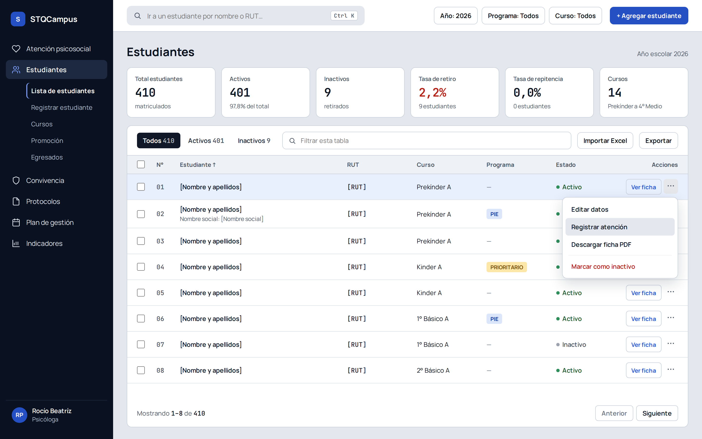
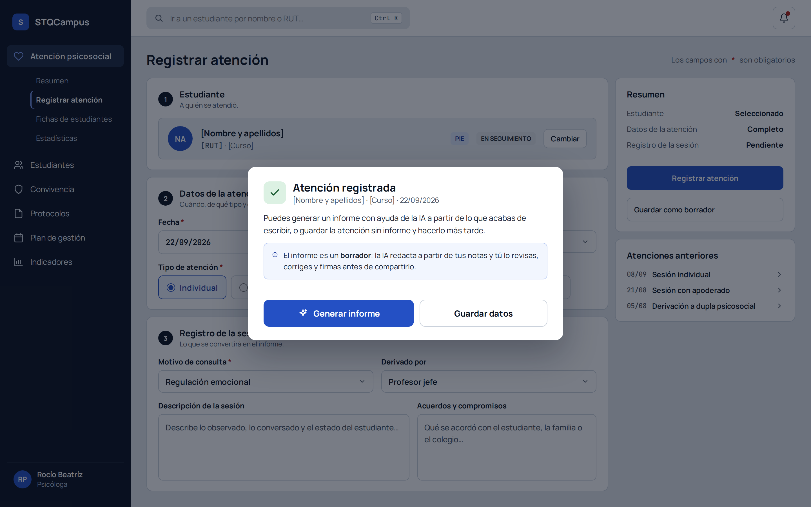

<div align="center">

# STQCampus

**Plataforma web de gestión psicosocial y convivencia escolar**

Proyecto de título · Ingeniería en Informática · Inacap La Serena

</div>

---

## Descripción

STQCampus es una plataforma web que centraliza la gestión psicosocial y de convivencia escolar de un establecimiento educacional: registro de atenciones, fichas de estudiantes, conflictos, protocolos, anotaciones e indicadores de bienestar.

El sistema está pensado para el equipo de convivencia escolar y psicología, e incluye apoyo de inteligencia artificial para redactar borradores de informes a partir de las notas de cada atención.

> **Estado del proyecto:** rediseño de interfaz (prototipo navegable). El desarrollo del backend está en preparación.

## Capturas

| Inicio de sesión | Atención psicosocial |
|---|---|
|  |  |

| Lista de estudiantes | Registro de atención con IA |
|---|---|
|  |  |

## Módulos

**Gestión de estudiantes**
- Lista de estudiantes con filtros por estado, curso y programa (PIE, prioritario)
- Registro individual e importación masiva desde Excel
- Cursos, promoción de fin de año y egresados

**Atención psicosocial**
- Registro de atenciones con motivo, urgencia, descripción y acuerdos
- Generación de informes asistida por IA (borrador revisable por el profesional)
- Fichas de estudiantes y estadísticas

**Convivencia escolar**
- Conflictos y mediaciones
- Protocolos de actuación
- Anotaciones por curso y situación conductual
- Plan de gestión de convivencia e indicadores de bienestar

## Tecnologías

| Capa | Tecnología |
|---|---|
| Backend | Python · Django |
| Base de datos | MySQL 8 (InnoDB, utf8mb4) |
| Frontend | Plantillas Django · HTML · CSS |
| Prototipo | HTML estático (carpeta `pantallas/`) |

## Estructura del repositorio

```
.
├── index.html        # Índice del prototipo navegable
├── pantallas/        # Pantallas del prototipo en HTML
│   └── fuentes/      # Tipografías incluidas
└── imagenes/         # Capturas de cada pantalla
    ├── 1_General/
    ├── 2_Estudiantes/
    └── 3_Convivencia/
```

## Cómo ver el prototipo

1. Clona o descarga el repositorio.
2. Abre la carpeta en Visual Studio Code.
3. Clic derecho sobre `index.html` → **Open with Live Server**.

También puedes abrir `index.html` directamente en el navegador con doble clic.

## Instalación del sistema (en preparación)

```bash
# Clonar el repositorio
git clone https://github.com/smlettura/Plataforma-STQ-v1.git
cd Plataforma-STQ-v1

# Entorno virtual
python -m venv venv
venv\Scripts\activate        # Windows
source venv/bin/activate     # macOS y Linux

# Dependencias
pip install -r requirements.txt

# Variables de entorno
copy .env.example .env       # y completar los datos de conexión

# Base de datos y ejecución
python manage.py migrate
python manage.py createsuperuser
python manage.py runserver
```

## Protección de datos

El sistema maneja datos personales sensibles de estudiantes, por lo que considera:

- Acceso restringido por roles y registro de auditoría de las acciones
- Datos de prueba anonimizados en el repositorio: no se incluyen nombres, RUT ni información real de estudiantes
- Respaldos periódicos de la base de datos
- Tratamiento de datos conforme a la Ley 21.719 sobre protección de datos personales

## Autores

- Simón Andrés Martí Lettura — [@smlettura](https://github.com/smlettura)
- Diego Vicente Martí Lettura
- Eric Mauricio Torres Mardones

## Licencia

Proyecto académico de uso restringido. El escudo y la identidad visual del establecimiento son propiedad del colegio y se utilizan con su autorización.
